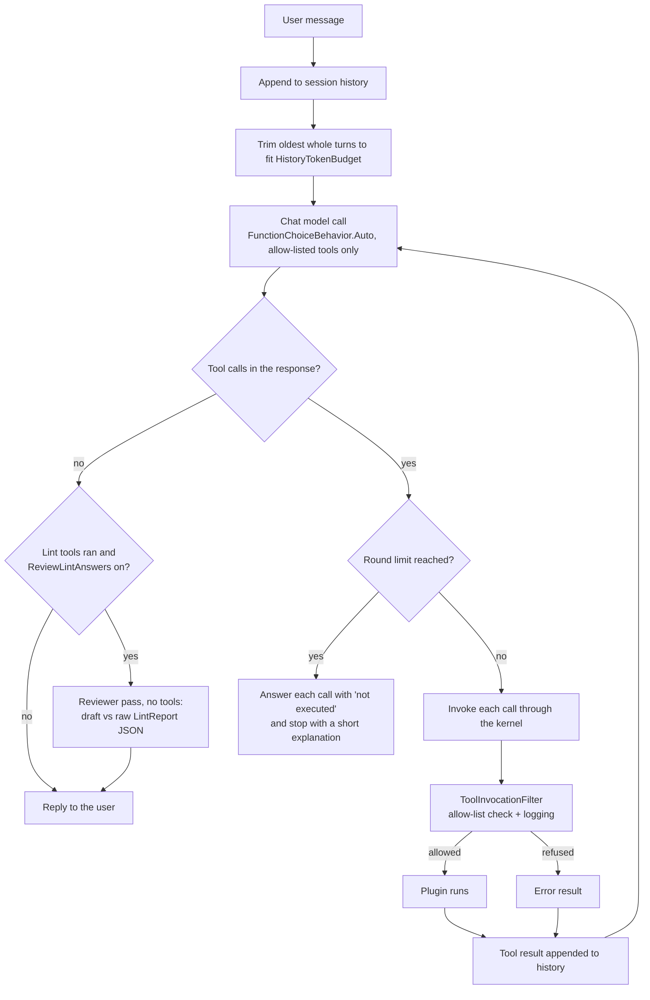

# semantic-kernel-agent

A DevOps assistant built in C# on [Microsoft Semantic Kernel](https://github.com/microsoft/semantic-kernel).
A chat model decides which tools to call; the tools are ordinary C# code that lint Kubernetes manifests,
Dockerfiles, Helm charts, Terraform and GitHub Actions workflows, summarize application logs, search a folder of
markdown runbooks, and do time arithmetic. It runs as an ASP.NET Core API (with a server-sent-events streaming
endpoint), as an interactive console REPL, or as a non-interactive `lint` command for CI pipelines.

The linters and the log analyzer work on their own: the `/lint/*` endpoints, the REPL's slash commands and
`devops-agent lint` call them directly, with no model and no network.

## What the tools do

| Plugin | Functions | Checks / output |
| --- | --- | --- |
| `kubernetes` | `lint_manifest`, `lint_manifest_file` | YamlDotNet over every document (and `kind: List` items). K8S001 missing namespace, K8S002 missing cpu/memory limits, K8S003/K8S004 missing liveness/readiness probes (not required for Jobs, CronJobs and run-once Pods), K8S005 `latest` or untagged image (digests count as pinned, registry ports are not tags), K8S006 privileged container. |
| `dockerfile` | `lint_dockerfile`, `lint_dockerfile_file` | Its own small parser (continuations, comments, `# escape=`, heredocs). DF001 unpinned base image (global `ARG` defaults are substituted; `scratch` and earlier stages are skipped), DF002 final stage runs as root, DF003 `ADD` used for local files (URLs and archives are allowed), DF004 no `HEALTHCHECK` in the final stage, DF005 `apt-get install` without clearing `/var/lib/apt/lists` in the same `RUN`. |
| `helm` | `lint_helm_chart` | HELM000 missing or invalid `Chart.yaml`/`values.yaml`. Templates are rendered against the chart's default values and the Kubernetes rules run on the output: HELM002 unpinned image, HELM003 missing resource limits, HELM004/HELM005 missing probes, HELM006 privileged container, HELM001 (info) a template the renderer could not turn into YAML. Findings name the template file and line, and the `values.yaml` key and line when the template reads the setting from `.Values`. |
| `terraform` | `lint_terraform`, `lint_terraform_path` | A small HCL structure parser; the `.tf` files of a module are checked together. TF001 provider without a version or not in `required_providers`, TF002 (info) version with no upper bound, TF003 registry module without `version` or git module without `?ref=`, TF010 ingress from `0.0.0.0/0` or `::/0` (AWS security groups and rules, Azure NSG rules, GCP firewalls; error for 22, 3389 or all ports, info for 80/443 only), TF011 public IPs and publicly accessible databases, TF020 taggable resources without `tags`/`labels` (AWS provider `default_tags` count). Values computed from variables are not evaluated. |
| `github_actions` | `lint_workflow`, `lint_workflow_file` | GHA001 action or reusable workflow not pinned to a 40-character commit SHA (container actions need a digest), GHA002 checkout in a `pull_request_target` workflow (error when it checks out the PR head), GHA003 job without `permissions` and no workflow-level block, GHA004 `permissions: write-all`, GHA005 untrusted event fields (issue/PR titles and bodies, comments, `head_ref`, ...) interpolated into a `run` script. |
| `logs` | `analyze_log_file`, `analyze_log_text` | Plain text, logfmt and JSON lines. Stack traces fold into the entry above them. Counts per level, and groups ERROR/FATAL entries by a signature with timestamps, GUIDs, IPs, hex ids, quoted values and numbers masked; returns the top N with counts and first/last line. |
| `runbooks` | `search_runbooks` | Searches the markdown runbooks under `Runbooks:Directory` and returns the best sections, each with a `file:line (heading)` citation. See below. |
| `time` | `utc_now`, `convert_time`, `time_since` | Current UTC time, IANA time-zone conversion, elapsed time since a timestamp. |

Lint results are a structured `LintReport` (rule id, rule name, severity, message, line, file for multi-file
inputs, target such as `Deployment/web container=nginx`, plus counts and `passed`). The same object is returned
by the API and handed to the model as the tool result, serialized as JSON.

File-reading functions only see a single workspace directory: paths are resolved against `Workspace:Root`,
and absolute paths, paths that climb out of the root, files that are themselves links, and files over
`Workspace:MaxFileBytes` are refused. Directory listings skip links and stop at 1,000 files.

### Helm rendering

Helm itself is not used. `HelmTemplateRenderer` implements the parts of Go templates that chart templates mostly
use: `.Values`/`.Chart`/`.Release` lookups, pipelines, common Sprig functions (`default`, `quote`, `toYaml`,
`nindent`, `printf`, `trunc`, ...), `if`/`else if`/`else`, `with`, `range` with variables, `$` and whitespace
trimming. `include` renders the name of the named template rather than its body, and unknown functions render
nothing but count as true in conditions, so optional blocks are linted rather than skipped. Each rendered line
remembers the template line it came from, which is how findings point back into the template.

### Runbook search

Runbooks are split into sections at markdown headings (headings inside code fences are ignored, long sections are
split at paragraphs), indexed on first use and re-indexed when a file is added, removed or changed.

* With `Embeddings:ModelId` set, sections are embedded once through an OpenAI-compatible embedding endpoint
  (`Microsoft.Extensions.AI`'s `IEmbeddingGenerator`; endpoint and key default to the chat model's) and ranked by
  cosine similarity to the query.
* Without an embedding model, when the embedding call fails, or when no section reaches
  `Runbooks:MinSimilarity`, sections are ranked with BM25, and the result's `note` says why.

`samples/runbooks` holds four example runbooks. The tests use a deterministic hashing embedding generator, so
they never call a model.

## The agent loop



* **Automatic function calling, agent-side invocation.** Every request carries
  `FunctionChoiceBehavior.Auto(allowedFunctions, autoInvoke: false)`: the model chooses tools on its own, and
  `DevOpsAgent` invokes them. Owning the loop means streaming and non-streaming chat share it, any
  `IChatCompletionService` works with it (including the scripted fake the tests use), and each call is recorded
  in the reply.
* **Filter.** `ToolInvocationFilter` is an `IFunctionInvocationFilter`, so it runs for every kernel function
  invocation. It refuses anything outside `Agent:AllowedTools` (`plugin.function`, `plugin.*` or `*`) before the
  function runs and logs each call with truncated arguments, duration and failures. Only allowed functions are
  advertised to the model in the first place; the filter covers a model that names one anyway.
* **Errors go back to the model.** A refused call, a missing function or an exception inside a plugin becomes
  an `Error: ...` tool result, so the model can explain it or try something else.
* **Bounded.** After `Agent:MaxToolRounds` rounds the request switches to `FunctionChoiceBehavior.None`. If the
  model still asks for tools, every call is answered with a "not executed" result so the history stays valid.
  Messages longer than `Agent:MaxMessageCharacters` are refused.
* **Reviewer pass.** With `Agent:ReviewLintAnswers` on, a turn in which lint tools ran ends with a second model
  call that has no tools: the reviewer gets the question, the draft answer and the raw `LintReport` JSON, and
  replies with a JSON verdict, either approving the draft or returning a corrected answer that replaces it (in the
  reply and in the history). Before that, a deterministic check flags rule ids the draft cites that no result
  contains. The verdict (`approved`, `revised`, `flagged`, or `unavailable` when the reviewer failed and the draft
  was kept) is returned in `review`; when streaming, a `review` event arrives before `done`, and the streamed
  deltas were the draft. It costs one extra model call on those turns, so it is off by default.
* **Sessions and trimming.** History is kept per session id, and turns of one session run one at a time. Before
  each request the oldest whole turns are dropped until the estimated size fits `Agent:HistoryTokenBudget`. A
  turn runs from a user message to the next one, so a tool call is never separated from its result. The system
  prompt and the current turn are always kept. The estimate is character-based (about four characters per token
  plus a per-message overhead); `ITokenCounter` can be replaced with a real tokenizer.
* **Failed turns are rolled back.** If the model call throws, or a streaming client disconnects, everything
  that turn added is removed from the session and nothing is saved, so no half-finished tool exchange is sent
  next time.

### Session storage

`IChatSessionStore` loads a session at the start of a turn and saves it when the turn completes.

* `Sessions:Provider = Memory` (default): sessions live in process memory and are lost on restart.
* `Sessions:Provider = Sqlite`: sessions are stored with EF Core in SQLite (`Sessions:ConnectionString`). Pending
  migrations are applied at startup. Messages are stored as a compact JSON shape that keeps text, tool calls (id,
  function, arguments) and tool results and drops connector metadata; a save rewrites the session's rows in one
  transaction. Recently used sessions are also cached in memory, which is what keeps turns of one session
  serialized, so with several replicas a client must stay on one replica (the Kubernetes Service uses ClientIP
  affinity for this).

Either way, at most `Agent:MaxSessions` sessions are held in memory (the least recently active idle one is evicted;
a session with a turn in progress never is), and `ChatSessionCleanupService` deletes sessions idle for longer than
`Sessions:Ttl` at startup and every `Sessions:CleanupInterval`.

Migrations live in `src/Agent.Persistence/Migrations`. The EF tool is pinned in `.config/dotnet-tools.json`:

```bash
dotnet tool restore
dotnet dotnet-ef migrations add <Name> --project src/Agent.Persistence --output-dir Migrations
```

## Running it

Requires the .NET 8 SDK.

```bash
dotnet build
dotnet test
```

### API

```bash
# OpenAI
ChatModel__ApiKey=sk-... dotnet run --project src/Agent.Api --urls http://localhost:5080

# Ollama (OpenAI-compatible API, no key needed)
ollama pull llama3.1
ChatModel__Endpoint=http://localhost:11434/v1 ChatModel__ModelId=llama3.1 \
  dotnet run --project src/Agent.Api --urls http://localhost:5080
```

The model needs to support tool calling. Without any `ChatModel` settings the API still starts: the lint
endpoints work, the chat endpoints return `503`, and `/health/ready` reports `Degraded`.

| Endpoint | Body | Response |
| --- | --- | --- |
| `POST /lint/k8s` | raw manifest YAML | `LintReport` JSON |
| `POST /lint/dockerfile` | raw Dockerfile | `LintReport` JSON |
| `POST /lint/terraform` | one raw `.tf` file | `LintReport` JSON |
| `POST /lint/github-actions` | raw workflow YAML | `LintReport` JSON |
| `POST /chat` | `{"sessionId": "optional", "message": "..."}` | `{"sessionId", "reply", "toolCalls": [{"tool", "succeeded", "error"}], "review"?}` |
| `POST /chat/stream` | same as `/chat` | `text/event-stream`: `tool_call`, `tool_result`, `delta`, `review` events, then `done` (the `/chat` response) or `error` |
| `DELETE /chat/{sessionId}` | | `204`, or `404` for an unknown session |
| `GET /health/live` | | runs no checks; for liveness probes |
| `GET /health/ready`, `GET /health` | | workspace, chat model, runbook folder and (with SQLite) session database checks; `503` when unhealthy |
| `GET /metrics` | | Prometheus metrics |
| `GET /swagger` | | Swagger UI; the document is `/swagger/v1/swagger.json` |

Helm charts are directories, so they are linted through the agent, the REPL or `devops-agent lint` rather than
over HTTP.

```bash
curl -s localhost:5080/lint/dockerfile --data-binary @samples/docker/Dockerfile.bad -H "Content-Type: text/plain"

curl -s localhost:5080/chat -H "Content-Type: application/json" \
  -d '{"sessionId": "demo", "message": "Lint samples/helm/bad-chart and tell me what to fix first"}'

curl -N localhost:5080/chat/stream -H "Content-Type: application/json" \
  -d '{"sessionId": "demo", "message": "What are the most frequent errors in samples/logs/orders-api.log, and what does the runbook say?"}'
```

Without a session id a new one is generated and returned. Errors are RFC 7807 problem details that carry the
request (`instance`) and a `traceId`: `400` (bad session id, empty or over-long message, malformed JSON), `401`
(missing or wrong API key), `413` (body over the limit), `429` (rate limited, with `Retry-After`), `503` (no model
configured) and `502` (the model request failed).

#### Authentication, rate limits and request size

* **API keys.** When `Auth:ApiKeys` lists keys (`Name`, `Key` of 16+ characters), the chat and lint endpoints
  require one in the `X-Api-Key` header. Keys are compared as SHA-256 hashes in constant time. With no keys
  configured the endpoints are open and the API logs a warning at startup; that is meant for local use only.
  Health, metrics and the OpenAPI document never require a key.
* **Rate limits.** Each API key (or client IP when auth is off) has its own token bucket of
  `RateLimiting:Burst` requests refilled at `RateLimiting:PermitsPerMinute`; a key's own `PermitsPerMinute`
  overrides the default, and `0` means unlimited.
* **Request size.** Chat bodies are limited to `Api:MaxChatRequestBytes` and lint bodies to
  `Workspace:MaxFileBytes`. The limits are endpoint metadata that Kestrel enforces while reading, and a request
  that declares a larger `Content-Length` is refused before its body is read.

#### Observability

The API exports through OpenTelemetry:

* **Traces.** Each turn is an `invoke_agent devops-agent` span with a `chat` child span per model request and an
  `execute_tool <plugin.function>` child per tool call (GenAI semantic-convention names and attributes such as
  `gen_ai.tool.name` and `gen_ai.usage.input_tokens`). Semantic Kernel's own spans (kernel functions, and model
  calls when `Telemetry:SemanticKernelModelDiagnostics` is on; prompt text is never recorded), ASP.NET Core
  requests and outgoing HTTP calls are included.
* **Metrics.** `agent.tool.calls` (by `tool` and `outcome`: success, error, blocked), `agent.tool.duration`,
  `agent.model.calls` (by `operation`: chat or review, and `outcome`), `agent.model.duration`,
  `agent.model.tokens` (by `token.type`, when the model reports usage), `agent.review.verdicts`, plus Semantic
  Kernel, ASP.NET Core and HttpClient metrics. Tool names the kernel does not know are counted as `unknown`.
* **Export.** Prometheus scrapes `/metrics` (`Telemetry:PrometheusEndpoint`; it is not behind the API key, so
  restrict it at the network level). Setting `OTEL_EXPORTER_OTLP_ENDPOINT` also sends traces and metrics over OTLP.

### Console REPL

```bash
ChatModel__Endpoint=http://localhost:11434/v1 ChatModel__ModelId=llama3.1 dotnet run --project src/Agent.Cli
```

```
> /k8s samples/kubernetes/bad-deployment.yaml
> /helm samples/helm/bad-chart
> /tf samples/terraform/bad
> /gha samples/github-actions/bad-workflow.yml
> /runbooks payment gateway timeout
> Is anything in samples/kubernetes/bad-deployment.yaml a security problem?
  [tool] kubernetes.lint_manifest_file ... ok
...
```

Plain lines go to the agent and the reply streams in; `/reset` clears the conversation, `/exit` quits, and
Ctrl+C cancels a reply in progress. The lint, log and runbook commands work without a chat model. REPL sessions
are kept in memory.

### `devops-agent lint` in CI

```bash
dotnet run --project src/Agent.Cli -- lint deploy/ charts/ Dockerfile
dotnet run --project src/Agent.Cli -- lint --format sarif --output lint.sarif --fail-on warning .
```

Paths are files or directories on the local disk (not limited to a workspace). A directory with `Chart.yaml` is
one Helm chart and a directory with `.tf` files is one Terraform module; other directories are searched, skipping
`.git`, `node_modules`, `bin`, `obj` and similar. Dockerfiles and `.tf` files are recognized by name; YAML files by
content (`jobs:` and `on:` is a workflow, `apiVersion:` and `kind:` is a manifest; anything else is skipped).
`--type` forces a kind.

| Option | Meaning |
| --- | --- |
| `-f`, `--format text\|json\|sarif` | Output format. SARIF 2.1.0 lists each rule once and points chart and module findings at the file inside them, so it can be uploaded to code-scanning tools. |
| `-o`, `--output <file>` | Write the report to a file. |
| `--fail-on error\|warning\|never` | Lowest severity that makes the exit code 1 (default `error`). |
| `-t`, `--type <kind>` | `kubernetes`, `dockerfile`, `helm`, `terraform` or `github-actions`. |

Exit codes: `0` passed, `1` findings at or above `--fail-on`, `2` usage error or a path that could not be linted.

## Deployment

### Docker

```bash
docker build -t semantic-kernel-agent-api:1.0.0 .
docker run --rm -p 8080:8080 -e ChatModel__ApiKey=sk-... semantic-kernel-agent-api:1.0.0
```

The image is multi-stage (SDK for the build, ASP.NET runtime for the final stage), runs as the non-root `app`
user, has a `HEALTHCHECK` against `/health`, and copies `samples/` to `/workspace`, which is the workspace root
inside the container. Mount your own files there with `-v "$PWD:/workspace:ro"`. `/data` is writable for the
SQLite session database. The repository's Dockerfile and Kubernetes manifests pass the project's own linters (a
test checks this).

### docker compose

```bash
# API only, against OpenAI or any OpenAI-compatible endpoint
OPENAI_API_KEY=sk-... CHAT_MODEL_ID=gpt-4o-mini docker compose up --build

# API plus a local Ollama server
CHAT_MODEL_ENDPOINT=http://ollama:11434/v1 docker compose --profile ollama up --build
docker compose exec ollama ollama pull llama3.1
```

The API runs read-only with SQLite sessions on a named volume and `samples/` mounted as the workspace. Ollama
only starts with the `ollama` profile. API keys are commented out in `docker-compose.yml`.

### Kubernetes

`deploy/kubernetes/base` is a Kustomize base: a namespace, a service account, a Deployment (startup, liveness and
readiness probes on `/health/live` and `/health/ready`, resource requests and limits, a read-only root filesystem,
all capabilities dropped, Prometheus scrape annotations), a ClusterIP Service with ClientIP affinity, a
HorizontalPodAutoscaler on CPU and memory, a PodDisruptionBudget, and a generated ConfigMap with the settings.
Secrets come from a `devops-agent-secrets` Secret that you create:

```bash
kubectl create namespace devops-agent
kubectl -n devops-agent create secret generic devops-agent-secrets \
  --from-literal=api-key-ci="$(openssl rand -hex 24)" \
  --from-literal=chat-model-api-key=sk-...
kustomize edit set image semantic-kernel-agent-api=<registry>/semantic-kernel-agent-api:<tag>   # in deploy/kubernetes/base
kubectl apply -k deploy/kubernetes/base
```

Sessions are stored in SQLite on an `emptyDir` per pod, so they survive container restarts but not pod
replacement, and each replica has its own; the Service's ClientIP affinity keeps a client on one pod.

## Configuration

Settings come from `appsettings.json` and can be overridden with environment variables (`Section__Key`).

| Key | Default | Meaning |
| --- | --- | --- |
| `ChatModel:ModelId` | `gpt-4o-mini` | Model name sent to the endpoint. |
| `ChatModel:Endpoint` | empty (api.openai.com) | Any OpenAI-compatible base URL, e.g. `http://localhost:11434/v1`. |
| `ChatModel:ApiKey` | empty | Required for OpenAI; not needed for local servers. Never commit it. |
| `Embeddings:ModelId` | empty | Embedding model for runbook search, e.g. `text-embedding-3-small` or `nomic-embed-text`. Empty means keyword search. |
| `Embeddings:Endpoint`, `Embeddings:ApiKey` | the chat model's | Override when embeddings come from a different server. |
| `Agent:AllowedTools` | all eight plugins (`kubernetes.*`, `dockerfile.*`, `helm.*`, `terraform.*`, `github_actions.*`, `logs.*`, `runbooks.*`, `time.*`) | Tools the model may call. |
| `Agent:MaxToolRounds` | `5` | Rounds of tool calls per turn before the model must answer. |
| `Agent:HistoryTokenBudget` | `8000` | Estimated tokens of history sent per request. |
| `Agent:MaxSessions` | `500` | Sessions held in memory. |
| `Agent:MaxMessageCharacters` | `16000` | Longest accepted user message. |
| `Agent:ReviewLintAnswers` | `false` | Run the reviewer pass on answers based on lint results. |
| `Agent:SystemPrompt`, `Agent:ReviewerPrompt` | see `AgentOptions` | System messages for the agent and the reviewer. |
| `Workspace:Root` | `.` (current directory) | The only directory file-reading tools can read. |
| `Workspace:MaxFileBytes` | `1048576` | Largest file a tool reads; also the body limit for `/lint/*`. |
| `Runbooks:Directory` | `samples/runbooks` | Runbook folder, relative to the workspace root. |
| `Runbooks:MinSimilarity` | `0.3` | Lowest cosine similarity for a semantic match. |
| `Sessions:Provider` | `Memory` | `Memory` or `Sqlite`. |
| `Sessions:ConnectionString` | `Data Source=sessions.db` | SQLite connection string. |
| `Sessions:Ttl` | `1.00:00:00` | Idle time after which a session is deleted; `0` keeps sessions. |
| `Sessions:CleanupInterval` | `00:10:00` | How often expired sessions are deleted. |
| `Auth:ApiKeys` | empty | `[{ "Name": "...", "Key": "...", "PermitsPerMinute": optional }]`. Empty leaves the API open. |
| `RateLimiting:PermitsPerMinute`, `RateLimiting:Burst` | `60`, `20` | Per-client token bucket. |
| `Api:MaxChatRequestBytes` | `65536` | Largest chat request body. |
| `Telemetry:ServiceName` | `devops-agent-api` | OpenTelemetry service name. |
| `Telemetry:SemanticKernelModelDiagnostics` | `true` | Semantic Kernel's GenAI spans and metrics for model calls. |
| `Telemetry:PrometheusEndpoint` | `/metrics` | Scrape path; empty turns it off. |
| `OTEL_EXPORTER_OTLP_ENDPOINT` | unset | When set, traces and metrics are also exported over OTLP. |

A chat model is registered when `ChatModel:ApiKey` or `ChatModel:Endpoint` is set.

## Tests

`dotnet test` runs xUnit tests that never call a real model:

* each linter rule against the good and bad files in `samples/`, plus edge cases (digests, registry ports,
  build args, heredocs, cache mounts, run-once workloads; Helm rendering of pipelines, conditionals, `range`,
  trimming and line mapping; HCL heredocs, interpolation and one-line blocks; Terraform port ranges per cloud;
  action pinning and script injection patterns);
* log grouping over `samples/logs/orders-api.log`, JSON lines and logfmt;
* runbook chunking, BM25 ranking, semantic ranking with a deterministic hashing embedding generator, and the
  keyword fallbacks;
* workspace path checks and directory listing, the allow-list and the filter (blocked calls never reach the plugin);
* history trimming, the in-memory and SQLite session stores (a restart keeps tool calls intact, migrations match
  the model, expiry skips busy sessions) and the cleanup job on a fake clock;
* agent round trips with `ScriptedChatCompletionService`, a fake `IChatCompletionService` that emits tool
  calls and answers in sequence: the requested plugin runs through the kernel and filter and its result
  reaches the next model request; refused and failing tools; the round limit; rollback of a failed turn;
  streaming with chunked tool-call updates; the reviewer pass approving, revising, flagging and failing;
* telemetry: span structure and parents (also across streaming yields), outcomes, and metric values;
* the API in-process with `WebApplicationFactory`: the SSE stream, API keys and per-key rate limits, size limits,
  problem details, health checks, the OpenAPI document, the Prometheus endpoint and a conversation that survives
  a restart with SQLite;
* `devops-agent lint` argument parsing, detection, exit codes and SARIF output, and the repository's own
  Dockerfile and Kubernetes manifests passing the linters.

## Layout

```
src/
  Agent.Core/          plugins, linters, runbook search, reviewer, telemetry, history, DevOpsAgent, DI registration
    Plugins/           kernel functions (kubernetes, dockerfile, helm, terraform, github_actions, logs, runbooks, time)
    Linting/           Kubernetes, Dockerfile and GitHub Actions linters, LintReport
      Helm/            HelmTemplateRenderer, HelmChartLinter
      Terraform/       HclParser, TerraformLinter
      Reporting/       LintRunner (file-system targets) and text/JSON/SARIF output
    Runbooks/          MarkdownChunker, Bm25Index, RunbookSearchService
    Review/            LintAnswerReviewer
    Telemetry/         AgentTelemetry (activity source and meter)
    Logs/              LogAnalyzer and its report types
    Filters/           ToolAllowList, ToolInvocationFilter
    History/           session store abstraction, in-memory store, token counting, trimming
    Workspace/         sandboxed file access
  Agent.Persistence/   EF Core SQLite session store, migrations, cleanup job
  Agent.Api/           minimal API: chat, SSE stream, lint, security, health, OpenAPI, telemetry
  Agent.Cli/           console REPL and the lint command
tests/Agent.Tests/     xUnit tests, the scripted chat service and the hashing embedding generator
samples/               manifests, Dockerfiles, Helm charts, Terraform, workflows, runbooks and a log
deploy/kubernetes/     Kustomize base
Dockerfile             multi-stage image for the API
docker-compose.yml     API with SQLite sessions, optional Ollama
```

## Stack

.NET 8, Microsoft.SemanticKernel 1.81.0 (stable packages only, with the OpenAI connector),
Microsoft.Extensions.AI for embeddings, EF Core 8 with SQLite, YamlDotNet, ASP.NET Core minimal APIs with
built-in rate limiting and health checks, Swashbuckle, OpenTelemetry 1.20 (the Prometheus exporter package is a
prerelease, `1.20.1-beta.1`), xUnit.

## License

MIT, see [LICENSE](LICENSE).
