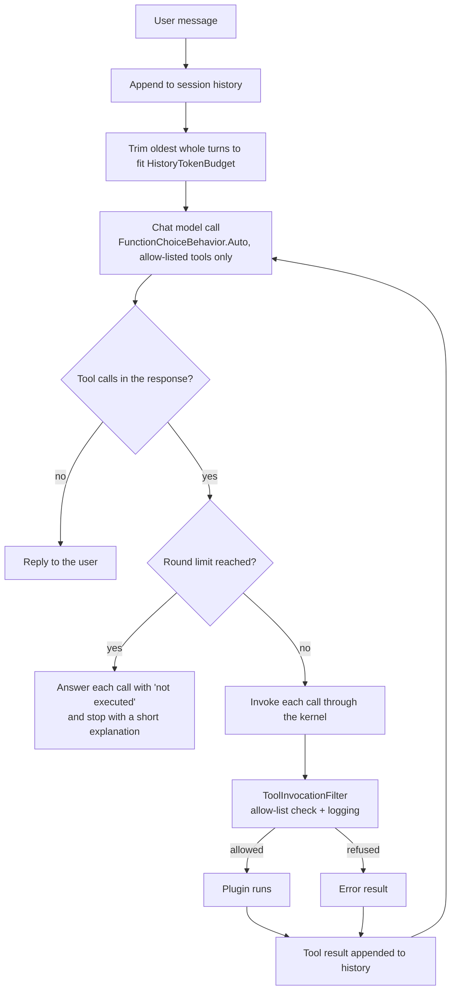

# semantic-kernel-agent

A DevOps assistant built in C# on [Microsoft Semantic Kernel](https://github.com/microsoft/semantic-kernel).
A chat model decides which tools to call; the tools are ordinary C# code that lint Kubernetes manifests and
Dockerfiles, summarize application logs, and do time arithmetic. It runs as an ASP.NET Core API (with a
server-sent-events streaming endpoint) or as an interactive console REPL.

The linters and the log analyzer work on their own: the `/lint/*` endpoints and the REPL's `/k8s`, `/docker` and
`/logs` commands call them directly, with no model and no network.

## What the tools do

| Plugin | Functions | Checks / output |
| --- | --- | --- |
| `kubernetes` | `lint_manifest`, `lint_manifest_file` | YamlDotNet over every document (and `kind: List` items). K8S001 missing namespace, K8S002 missing cpu/memory limits, K8S003/K8S004 missing liveness/readiness probes (not required for Jobs, CronJobs and run-once Pods), K8S005 `latest` or untagged image (digests count as pinned, registry ports are not tags), K8S006 privileged container. |
| `dockerfile` | `lint_dockerfile`, `lint_dockerfile_file` | Its own small parser (continuations, comments, `# escape=`, heredocs). DF001 unpinned base image (global `ARG` defaults are substituted; `scratch` and earlier stages are skipped), DF002 final stage runs as root, DF003 `ADD` used for local files (URLs and archives are allowed), DF004 no `HEALTHCHECK` in the final stage, DF005 `apt-get install` without clearing `/var/lib/apt/lists` in the same `RUN`. |
| `logs` | `analyze_log_file`, `analyze_log_text` | Plain text, logfmt and JSON lines. Stack traces fold into the entry above them. Counts per level, and groups ERROR/FATAL entries by a signature with timestamps, GUIDs, IPs, hex ids, quoted values and numbers masked; returns the top N with counts and first/last line. |
| `time` | `utc_now`, `convert_time`, `time_since` | Current UTC time, IANA time-zone conversion, elapsed time since a timestamp. |

Lint results are a structured `LintReport` (rule id, rule name, severity, message, line, target such as
`Deployment/web container=nginx`, plus counts and `passed`). The same object is returned by the API and
handed to the model as the tool result, serialized as JSON.

File-reading functions only see a single workspace directory: paths are resolved against `Workspace:Root`,
and absolute paths, paths that climb out of the root, files that are themselves links, and files over
`Workspace:MaxFileBytes` are refused.

## The agent loop



* **Automatic function calling, agent-side invocation.** Every request carries
  `FunctionChoiceBehavior.Auto(allowedFunctions, autoInvoke: false)`: the model chooses tools on its own, and
  `DevOpsAgent` invokes them. Owning the loop means streaming and non-streaming chat share it, any
  `IChatCompletionService` works with it (including the scripted fake the tests use), and each call is recorded
  in the reply.
* **Filter.** `ToolInvocationFilter` is an `IFunctionInvocationFilter`, so it runs for every kernel function
  invocation. It refuses anything outside `Agent:AllowedTools` (`plugin.function`, `plugin.*` or `*`) before the
  function runs and logs each call with truncated arguments, duration and failures. Only allowed functions are
  advertised to the model in the first place; the filter covers a model that names one anyway.
* **Errors go back to the model.** A refused call, a missing function or an exception inside a plugin becomes
  an `Error: ...` tool result, so the model can explain it or try something else.
* **Bounded.** After `Agent:MaxToolRounds` rounds the request switches to `FunctionChoiceBehavior.None`. If the
  model still asks for tools, every call is answered with a "not executed" result so the history stays valid.
* **Sessions and trimming.** History is kept per session id in memory (least recently active sessions are
  evicted past `Agent:MaxSessions`), and turns of one session run one at a time. Before each request the oldest
  whole turns are dropped until the estimated size fits `Agent:HistoryTokenBudget`. A turn runs from a user
  message to the next one, so a tool call is never separated from its result. The system prompt and the
  current turn are always kept. The estimate is character-based (about four characters per token plus a
  per-message overhead); `ITokenCounter` can be replaced with a real tokenizer.
* **Failed turns are rolled back.** If the model call throws, or a streaming client disconnects, everything
  that turn added is removed from the session, so no half-finished tool exchange is sent next time.

## Running it

Requires the .NET 8 SDK.

```bash
dotnet build
dotnet test
```

### API

```bash
# OpenAI
ChatModel__ApiKey=sk-... dotnet run --project src/Agent.Api --urls http://localhost:5080

# Ollama (OpenAI-compatible API, no key needed)
ollama pull llama3.1
ChatModel__Endpoint=http://localhost:11434/v1 ChatModel__ModelId=llama3.1 \
  dotnet run --project src/Agent.Api --urls http://localhost:5080
```

The model needs to support tool calling. Without any `ChatModel` settings the API still starts: the lint
endpoints work and the chat endpoints return `503`.

| Endpoint | Body | Response |
| --- | --- | --- |
| `POST /lint/k8s` | raw manifest YAML | `LintReport` JSON |
| `POST /lint/dockerfile` | raw Dockerfile | `LintReport` JSON |
| `POST /chat` | `{"sessionId": "optional", "message": "..."}` | `{"sessionId", "reply", "toolCalls": [{"tool", "succeeded", "error"}]}` |
| `POST /chat/stream` | same as `/chat` | `text/event-stream`: `tool_call`, `tool_result`, `delta` events, then `done` (the `/chat` response) or `error` |
| `DELETE /chat/{sessionId}` | | `204`, or `404` for an unknown session |
| `GET /health` | | `{"status": "ok"}` |

```bash
curl -s localhost:5080/lint/dockerfile --data-binary @samples/docker/Dockerfile.bad -H "Content-Type: text/plain"

curl -s localhost:5080/chat -H "Content-Type: application/json" \
  -d '{"sessionId": "demo", "message": "Lint samples/kubernetes/bad-deployment.yaml and tell me what to fix first"}'

curl -N localhost:5080/chat/stream -H "Content-Type: application/json" \
  -d '{"sessionId": "demo", "message": "What are the most frequent errors in samples/logs/orders-api.log?"}'
```

Without a session id a new one is generated and returned. Chat errors map to `400` (bad session id or empty
message), `503` (no model configured) and `502` (the model request failed).

### Console REPL

```bash
ChatModel__Endpoint=http://localhost:11434/v1 ChatModel__ModelId=llama3.1 dotnet run --project src/Agent.Cli
```

```
> /k8s samples/kubernetes/bad-deployment.yaml
> /docker samples/docker/Dockerfile.bad
> /logs samples/logs/orders-api.log 3
> Is anything in samples/kubernetes/bad-deployment.yaml a security problem?
  [tool] kubernetes.lint_manifest_file ... ok
...
```

Plain lines go to the agent and the reply streams in; `/reset` clears the conversation, `/exit` quits, and
Ctrl+C cancels a reply in progress. The slash commands work without a model.

### Docker

```bash
docker build -t semantic-kernel-agent-api .
docker run --rm -p 8080:8080 -e ChatModel__ApiKey=sk-... semantic-kernel-agent-api
# Ollama on the host:
docker run --rm -p 8080:8080 -e ChatModel__Endpoint=http://host.docker.internal:11434/v1 \
  -e ChatModel__ModelId=llama3.1 semantic-kernel-agent-api
```

The image is multi-stage (SDK for the build, ASP.NET runtime for the final stage), runs as the non-root `app`
user, has a `HEALTHCHECK` against `/health`, and copies `samples/` to `/workspace`, which is the workspace root
inside the container. Mount your own files there with `-v "$PWD:/workspace:ro"`. The repository's Dockerfile
passes the project's own Dockerfile linter.

## Configuration

Settings come from `appsettings.json` and can be overridden with environment variables (`Section__Key`).

| Key | Default | Meaning |
| --- | --- | --- |
| `ChatModel:ModelId` | `gpt-4o-mini` | Model name sent to the endpoint. |
| `ChatModel:Endpoint` | empty (api.openai.com) | Any OpenAI-compatible base URL, e.g. `http://localhost:11434/v1`. |
| `ChatModel:ApiKey` | empty | Required for OpenAI; not needed for local servers. Never commit it. |
| `Agent:AllowedTools` | `kubernetes.*`, `dockerfile.*`, `logs.*`, `time.*` | Tools the model may call. |
| `Agent:MaxToolRounds` | `5` | Rounds of tool calls per turn before the model must answer. |
| `Agent:HistoryTokenBudget` | `8000` | Estimated tokens of history sent per request. |
| `Agent:MaxSessions` | `500` | Sessions kept in memory. |
| `Agent:SystemPrompt` | see `AgentOptions` | System message for new sessions. |
| `Workspace:Root` | `.` (current directory) | The only directory file-reading tools can read. |
| `Workspace:MaxFileBytes` | `1048576` | Largest file a tool reads; also the body limit for `/lint/*`. |

A chat model is registered when `ChatModel:ApiKey` or `ChatModel:Endpoint` is set.

## Tests

`dotnet test` runs xUnit tests that never call a real model:

* each linter rule against the good and bad files in `samples/`, plus edge cases (digests, registry ports,
  build args, heredocs, cache mounts, run-once workloads);
* log grouping over `samples/logs/orders-api.log`, JSON lines and logfmt;
* workspace path checks, the allow-list and the filter (blocked calls never reach the plugin);
* history trimming (whole turns dropped, tool calls kept with their results, system prompt and current
  turn kept);
* agent round trips with `ScriptedChatCompletionService`, a fake `IChatCompletionService` that emits tool
  calls and answers in sequence: the requested plugin runs through the kernel and filter and its result
  reaches the next model request; refused and failing tools; the round limit; rollback of a failed turn;
  streaming with chunked tool-call updates;
* the API in-process with `WebApplicationFactory`, including the SSE stream.

## Layout

```
src/
  Agent.Core/          plugins, linters, log analyzer, filter, history, DevOpsAgent, DI registration
    Plugins/           kernel functions (kubernetes, dockerfile, logs, time)
    Linting/           KubernetesManifestLinter, DockerfileParser/Linter, LintReport
    Logs/              LogAnalyzer and its report types
    Filters/           ToolAllowList, ToolInvocationFilter
    History/           sessions, token counting, TokenBudgetHistoryTrimmer
    Workspace/         sandboxed file access
  Agent.Api/           minimal API: chat, SSE stream, lint endpoints
  Agent.Cli/           console REPL
tests/Agent.Tests/     xUnit tests and the scripted chat service
samples/               manifests, Dockerfiles and a log used by tests and demos
Dockerfile             multi-stage image for the API
```

## Stack

.NET 8, Microsoft.SemanticKernel 1.81.0 (stable packages only, with the OpenAI connector), YamlDotNet,
ASP.NET Core minimal APIs, xUnit.

## License

MIT, see [LICENSE](LICENSE).
